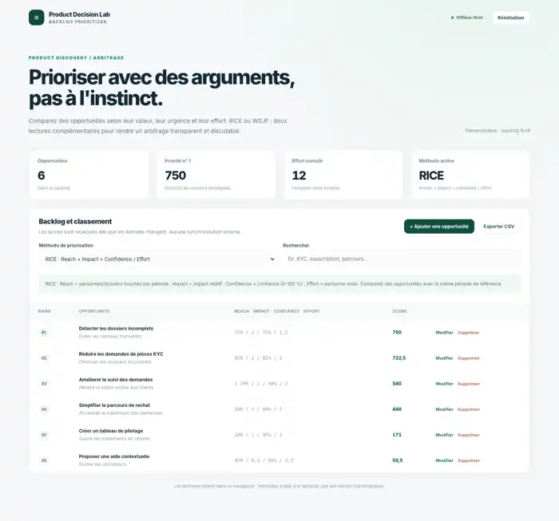

# Backlog Prioritizer — RICE & WSJF

**A lightweight Product Owner decision workbench to prioritize opportunities with transparent, revisable assumptions.**

This offline-first static app makes explicit the factors behind backlog ordering. Change the method from RICE to WSJF, compare the outcome, edit estimates, and export the ranking to CSV.

## Problem → product response

A backlog can become a list of requests ranked by the loudest stakeholder. Prioritization frameworks offer a structured conversation, but spreadsheets often hide assumptions and lack a clear comparison view.

This tool supports two complementary perspectives:

- **RICE** = Reach × Impact × Confidence / Effort. Reach is the estimated count of people or files impacted **in the same reference period**; confidence is a percentage; effort is expressed in person-months.
- **WSJF** = (Business Value + Time Criticality + Risk Reduction / Opportunity Enablement) / Job Size. Relative input factors use an illustrative 1–10 scale.

Scores are recalculated immediately, and rankings are sorted in descending order. They are **decision aids rather than objective facts**.

## Live demo / local run

- **Live demo:** once GitHub Pages is enabled, `https://goldaj.github.io/backlog-prioritizer/`.
- **Offline:** download, then double-click `index.html`. No installation, login, or API access needed.
- **Optional automated tests:** `node tests.js` (Node.js 18+).

## Included features

- Six fictional insurance/operations backlog examples (KYC, customer journey, tracking and automation).
- RICE ↔ WSJF toggle, each backed by an independent data set.
- Create, edit, delete, filter and automatically rank opportunities.
- Summary KPIs, explicit factor values, and semicolon-separated UTF-8 CSV export.
- Local-only persistence using `localStorage`; reset to demo data.

## Product thinking

- **Target users:** Product Owner, Business Analyst, Delivery Lead.
- **Core job:** Explain why feature A should precede feature B under current assumptions.
- **Expected outcome:** Higher quality prioritization conversations and traceable decision rationale.
- **Success metrics to validate:** proportion of items with explicit estimates, time spent preparing a quarterly prioritization, agreement on decision criteria.
- **Intentional limitations:** no authentication, shared workspace, external Jira import or 'AI priority score'; these would add complexity before demonstrating user value.

## Review scenario

1. Compare the six preloaded examples in RICE and WSJF.
2. Edit "Réduire les demandes de pièces KYC" and lower confidence to 30%.
3. Switch methodologies to observe how urgency and risk influence the ranking.
4. Export the new ranking for review.

The sample domain is fictional, with no real company data or proprietary operating rules.

## Technologies

HTML, CSS, vanilla JavaScript, localStorage. Works under `file://` and GitHub Pages. No build tooling or third-party dependencies. MIT license.

## Status and limits

This is an implemented portfolio prototype with a static browser interface, separate RICE/WSJF calculations, fictional examples, a screenshot, and an automated test script. The scoring logic supports discussion; it does not validate estimates or prove that a ranking improves business outcomes. No real-team usability study or production deployment evidence is included. Collaboration, authentication, and external backlog integrations are outside the current scope.
